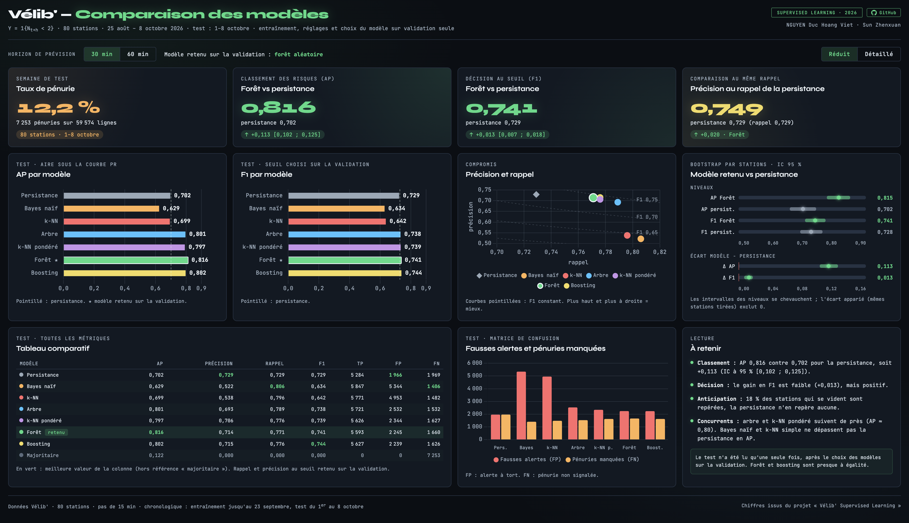

# Présentation du projet

Le système Vélib' repose sur la disponibilité des vélos dans chaque station : une station vide
empêche de prendre un vélo, une station pleine empêche d'en déposer un. L'état actuel ne suffit
pas, il faut anticiper.

**Question.** À partir de l'historique de disponibilité, une station Vélib' aura-t-elle moins de
deux vélos dans 30 ou 60 minutes ?

## Objectif

Le projet compare des modèles d'apprentissage supervisé pour cette prévision, formulée comme une
classification binaire :

$$
Y_{s,t} = \mathbb{1}\{N_{s,t+h} < 2\}, \qquad h \in \{30, 60\} \text{ minutes},
$$

où $N_{s,t+h}$ est le nombre de vélos disponibles dans la station $s$ à l'instant $t+h$. L'étude
porte sur 80 stations de Paris et de banlieue.

# Liste des parties

-   [Partie 1 : Exploration visuelle du réseau Vélib](chapters/Part1.qmd)
-   [Partie 2 : Qualité et préparation des données](chapters/Part2.qmd)
-   [Partie 3 : Modèles supervisés](chapters/Part3.qmd)
-   [Partie 4 : Comparaison des modèles](chapters/Part4.qmd)
-   [Partie 5 : Conclusion](chapters/Part5.qmd)

::: callout-note
## Consulter le rapport complet

Vous pouvez consulter le rapport détaillé du projet (format PDF) en cliquant sur le lien ci-dessous :

<a href="rapport/Rapport.pdf" target="_blank" style="font-weight: bold; text-decoration: underline;">  Ouvrir le rapport PDF </a>
:::

::: callout-note
## Consulter le dashboard

:::
